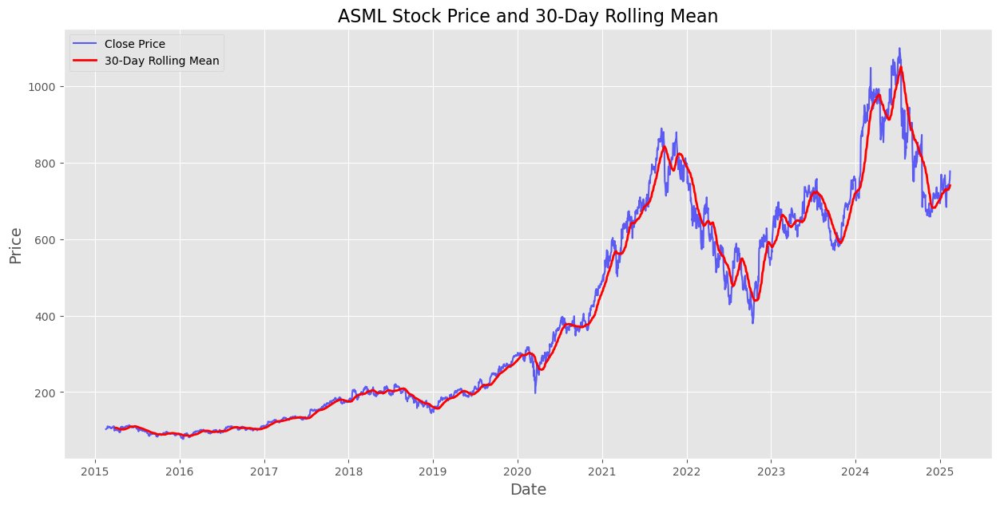
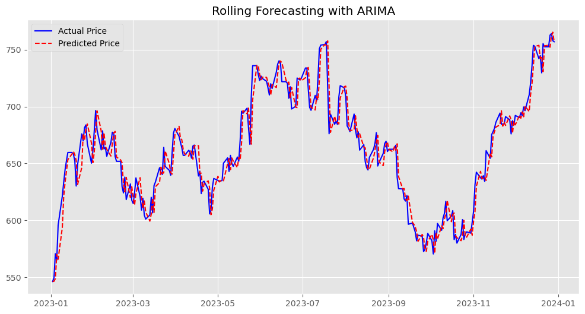
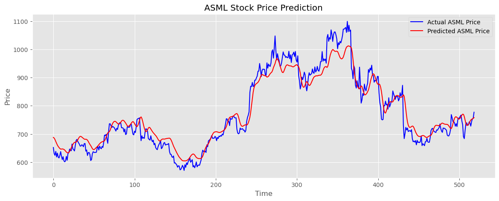
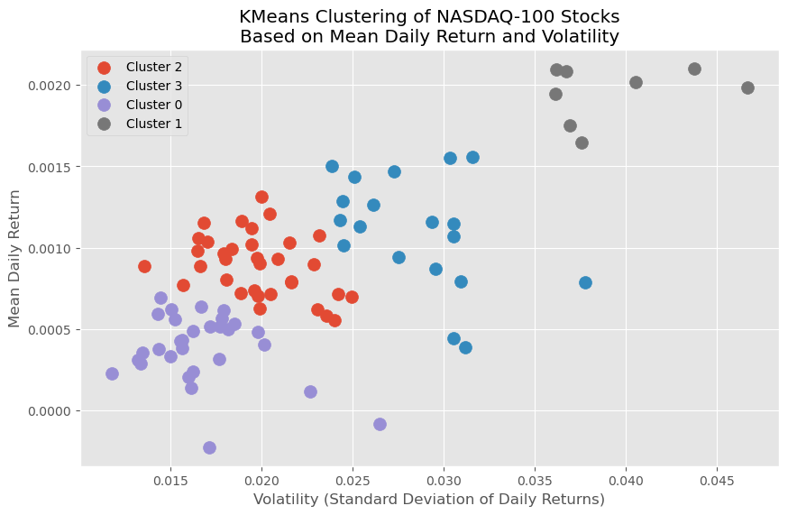
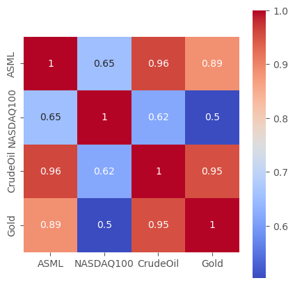
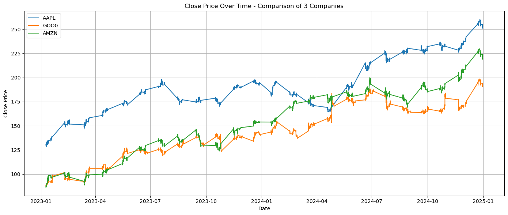

# 📈 Uncovering Market Intelligence: A NASDAQ-100 Data Challenge

Time series analysis, forecasting and machine learning on NASDAQ-100 stock data, built for a (fictional) fintech client as part of the **Applied Data Science & AI** programme at Breda University of Applied Sciences (Year 1, Block D, 2024-25).


<p align="center">
  
</p>

---

## 📌 Overview

**Move Tickers** is a SaaS company that delivers real-time market updates and data visualisation tools, and it is moving into wealth management. The company asked us, as data scientists, to find patterns in the stock market that could support trading strategies, alerts and dashboards on its platform.

In this project I:

- **Stored and queried** 10 years of financial data in PostgreSQL: NASDAQ-100 stocks, global indices, exchange rates, gold, crude oil and macroeconomic indicators.
- **Analysed** ASML and NASDAQ-100 time series: trends, volatility, seasonality, stationarity and correlations.
- **Forecast** stock prices with classical models (naïve, rolling mean, ARIMA) and machine learning (Linear/Lasso regression, Random Forest, XGBoost, MLP, LSTM).
- **Grouped** NASDAQ-100 companies by risk and return with clustering, and found outlier stocks with anomaly detection.
- **Built**, with my team, a minute-level prediction pipeline for Apple, Amazon and Alphabet.
- **Assessed** the proposed AI system against the **EU AI Act** and **GDPR**.

## 👥 Team & My Role

This was a team project (Group 11, four ADS&AI students) with individual and group parts. **My main role in the group was data engineering**: cleaning, transforming and preparing the data that the models were trained on.

| Part | Type | What it covers |
|------|------|----------------|
| [Time Series Analysis notebook](notebooks/01_time_series_analysis.ipynb) | 🧑 Individual | Time series handling, visualisation, ARIMA, regression, classification, clustering, anomaly detection, MLP and LSTM |
| [SQL queries](sql/) | 🧑 Individual | Filtering, aggregation, joins, `CASE`, window functions on the financial data warehouse |
| [Project proposal](reports/project_proposal.pdf) | 🧑 Individual | AI Project Canvas for an "AI Signal-of-the-Day Scorecard" |
| [EU AI Act & GDPR assessment](reports/eu_ai_act_gdpr_assessment.docx) | 🧑 Individual + 👥 Group | Risk level, legal obligations and GDPR measures |
| [ML Model Development notebook](notebooks/02_ml_model_development.ipynb) | 👥 Group | Data loading from PostgreSQL, preprocessing, feature engineering and modelling for AAPL, AMZN and GOOG |

## 📊 Key Results

### Forecasting the ASML closing price (one day ahead)

| Model | Test period | MAE | RMSE | R² |
|-------|-------------|----:|-----:|---:|
| Naïve (yesterday's price) | 2023 | 9.61 | 12.63 | – |
| 30-day rolling average | 2023 | 31.80 | 37.51 | – |
| ARIMA(2,1,2), fitted once | 2023 | 115.80 | 125.43 | – |
| **Walk-forward ARIMA(2,1,2)** | 2023 | – | **12.58** | – |
| Naïve regression baseline | last 20% of days | – | 20.56 | 0.9765 |
| Linear regression (5 price lags + VIX + oil) | last 20% of days | – | 20.39 | 0.9769 |
| **Lasso regression** | last 20% of days | – | **20.37** | **0.9769** |
| Random Forest | last 20% of days | – | 61.28 | 0.7910 |
| MLP (dense neural network) | last 20% of days | 286.85 | 294.65 | – |
| **LSTM** | last 20% of days | **28.22** | **35.85** | – |

**What I learned**

- **Evaluate fairly.** ARIMA fitted once looked terrible next to the naïve model. The naïve model gets to "see" yesterday's real price, while ARIMA forecast the whole test year in one go. Walk-forward ARIMA, retrained every day, gives a fair comparison and matches the naïve baseline.
- **Simple wins.** For next-day prices, simple linear models beat the more complex ones. Random Forest can't extrapolate above the price range it was trained on.
- **Sequence models help.** The LSTM followed the real price far better than the MLP.

### Predicting whether ASML goes up or down

Test set: a random 20% of days.

| Model | Accuracy |
|-------|---------:|
| Always predict "up" (majority class) | 55.0% |
| Logistic regression | 51.9% |
| **Logistic regression (L1)** | **53.1%** |
| Random Forest | 51.2% |
| XGBoost | 47.9% |

None of the models beat the simple "always up" baseline. Daily direction is close to random with these features, and that is a useful finding for Move Tickers: a buy/sell signal built on them would not be trustworthy.

### Clustering and anomaly detection (NASDAQ-100)

K-Means and hierarchical clustering grouped the NASDAQ-100 companies into 4 risk/return profiles, from low-volatility steady stocks to high-volatility high-return stocks. DBSCAN flagged **APP** and **AXON** as anomalies because of their extreme return and volatility, and **META** because of its unusually low volatility.

## 🖼️ Visual Highlights

| | |
|:---:|:---:|
|  |  |
| Walk-forward ARIMA vs. actual ASML price (2023) | LSTM prediction vs. actual ASML price |
|  |  |
| K-Means clusters of NASDAQ-100 stocks by return and volatility | Price correlation: ASML, NASDAQ-100, crude oil, gold |
|  | |
| Group project: minute-level prices of AAPL, GOOG and AMZN | |

## ⚖️ Responsible AI: EU AI Act & GDPR

I proposed an **"AI Signal-of-the-Day Scorecard"**: a daily 0-100 score that ranks NASDAQ-100 stocks by their chance of beating the index. In the [legal assessment](reports/eu_ai_act_gdpr_assessment.docx) I concluded:

- **Limited-risk AI system** under the EU AI Act. The tool only gives advice, a human makes every trade, it is used by professionals, and finance is not in the Annex III high-risk list unless the AI decides on credit or insurance.
- **Obligations:** be transparent that scores are AI-generated, provide clear instructions for use, and keep human oversight. High-risk duties (conformity assessment, EU database registration) do not apply.
- **GDPR:** the model uses no personal data, only public market data. The only personal data is user login metadata. Measures: data minimisation, a privacy notice, role-based access, encryption and a way for users to request deletion.

## 🗂️ Repository Structure

```
nasdaq100-market-intelligence/
├── notebooks/
│   ├── 01_time_series_analysis.ipynb   # individual: time series, forecasting and ML on ASML / NASDAQ-100
│   └── 02_ml_model_development.ipynb   # group: minute-level ML pipeline for AAPL, AMZN, GOOG
├── sql/                                # PostgreSQL queries, levels 1-4
├── data/                               # daily datasets (large files described in data/README.md)
├── models/                             # saved Keras models (best MLP and LSTM)
├── reports/                            # project proposal and EU AI Act / GDPR assessment
├── images/                             # charts used in this README
├── requirements.txt
└── .env.example                        # database settings template for notebook 02
```

## 🚀 How to Run

```bash
git clone <this-repo-url>
cd nasdaq100-market-intelligence

python -m venv .venv
source .venv/bin/activate        # Windows: .venv\Scripts\activate
pip install -r requirements.txt

jupyter notebook notebooks/
```

- **Notebook 01** runs with the files in `data/`. Only the minute-data and per-company clustering sections need the extra files described in [data/README.md](data/README.md).
- **Notebook 02** needs `data/model_input_data.csv`, or access to a PostgreSQL database with the `model_input_data` table. Set the variables from [`.env.example`](.env.example) as environment variables before running the database cell.

## 🔭 What I Would Improve Next

- Use **time-ordered splits** (`TimeSeriesSplit`) for the up/down classifier instead of a random split. This avoids look-ahead bias.
- Fit scalers on the training data only, and evaluate per company in the group pipeline.
- Finish the **LSTM training, hyperparameter tuning and backtesting** (with transaction costs) for the group model.
- Predict **returns instead of raw prices**, and add features like market breadth, sector momentum and news sentiment for the up/down classifier.
- Turn the best model into a small **dashboard or alert service**, as proposed for Move Tickers.

## 🛠️ Skills Demonstrated

`Python` · `pandas` · `NumPy` · `Matplotlib` · `Seaborn` · `SQL (PostgreSQL)` · `SQLAlchemy` · `statsmodels` · `ARIMA / auto-ARIMA` · `scikit-learn` · `XGBoost` · `TensorFlow / Keras (MLP, LSTM)` · `K-Means` · `Hierarchical clustering` · `DBSCAN` · `Feature engineering` · `Model evaluation` · `EU AI Act & GDPR` · `Teamwork (Agile / Scrum)`

## 🙏 Acknowledgements

This project was made during the **Applied Data Science & Artificial Intelligence** bachelor at **Breda University of Applied Sciences** (Year 1, Block D, 2024-25). The client case (Move Tickers) and datasets were provided by the university. Thanks to my teammates in Group 11 and to our mentors and lecturers for their guidance.
